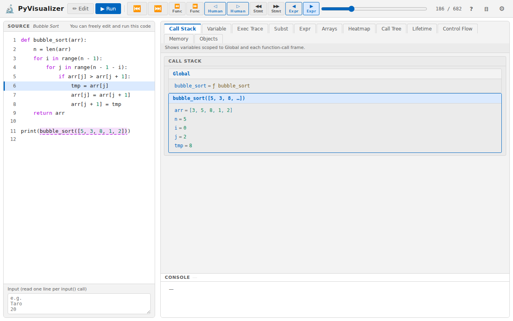

# PyVisualizer

> 🚀 **[Live Demo](https://tntetsu.github.io/PyVisualizer/)** — Hosted on GitHub Pages

> [日本語版 README はこちら](README.md)

> 📖 **[User manual](https://tntetsu.github.io/PyVisualizer/manual.en.html)** — also available from the “?” button at the top right of the app

An interactive, educational web application that visualizes Python program execution step by step.

PyVisualizer shares its screen and its **12 visualization views** with [JSVisualizer](https://github.com/tntetsu/JSVisualizer), the JavaScript version. Step through a Python program by expression, statement, or function call, and see how the program behaves — how the contents of memory change over time — from several angles.



No installation or sign-in is needed: just open it in a browser. All code runs inside your browser and is never sent to a server.

---

## Features

### An interpreter written for Python

Programs run on a Python interpreter built into PyVisualizer (written in JavaScript). Python code is not translated into JavaScript, so expressions whose meaning differs between the two languages — `[1, 2] + [3]`, `-7 % 3`, `if []:` — are evaluated the Python way.

Correctness is checked by running the same programs on CPython (`python3`) and comparing **the output, the exception type, and the sequence of variable states** (see [Testing](#testing)).

### Step granularity (8-direction buttons)

Four granularities × backward/forward = 8 step operations.

| Granularity | Buttons | Keyboard | Description |
|------|--------|-----------|------|
| **Expr** | ◀Expr / ▶Expr | `b`/`←`, `n`/`→` | One expression at a time (finest) |
| **Human** | ◁Human / ▷Human | `H` / `h` | Only meaningful changes: assignments, condition checks, the `for` loop variable taking its next value, function calls, etc. |
| **Stmt** | ◀◀Stmt / ▶▶Stmt | `V` / `v` | One statement at a time (skips sub-expressions) |
| **Func** | ⏪Func / ⏩Func | `F` / `f` | Jumps to the next function entry or return |

Also: `Home` → first step, `End` → last step, `1`–`9` → switch tabs, and a slider to jump to any point.

For Python, the Human step also stops at:

- each iteration of a `for` loop (where the loop variable takes its next value)
- each iteration of a comprehension
- the point where an `except` clause catches an exception

### Code highlighting (3 layers)

| Layer | Color | Meaning |
|----|-----|------|
| Line | 🟦 Blue (left border + background) | The line being executed |
| Expression | 🟧 Orange (translucent) | The range of the expression being evaluated |
| Caller | 🟣 Purple (dashed underline) | While inside a function, the expression that called it |

### Visualization views (12)

The views are shared with JSVisualizer. They are organized along two axes: **what is visualized** and **how time is shown** (a single moment, or the whole course of execution).

| Category | Target | Single moment (animation) | Over time (timeline) |
|----------|-----------|------------------|----------------|
| **State** | Variable values | Variable | Exec Trace |
| | Call stack | Call Stack | Lifetime |
| | Memory layout | Memory | — |
| **Behavior** | Expression evaluation | Expr | Subst |
| | Statement execution | Control Flow | Heatmap |
| | Function calls | Call Tree | — |
| **Composite** | Arrays (lists) | Arrays | Exec Trace |
| | Objects (dicts, instances) | Objects | — |

| Tab | Description |
|--------|------|
| Variable | A table of code lines × variables, showing each line's values as of its last execution; changed values are bold orange |
| Exec Trace | Lists the steps where assignments and condition checks happened, in execution order, with True / False for conditions and small diagrams of lists and index positions |
| Call Stack | Variable values for Global and for each active function call |
| Lifetime | Time on the horizontal axis and call depth on the vertical axis; each function call is a bar showing when it started and ended |
| Memory | Variables (stack) and the list / dict / instance objects (heap) drawn separately, with arrows for references |
| Expr | Shows a one-line expression being reduced to its final value part by part; parts skipped by `and`/`or` stay as written |
| Subst | Expands recursive calls with the substitution model: `fib(5)` → `fib(4) + fib(3)` → … |
| Control Flow | A flowchart with the branches of `if` in separate columns; shows how many times each line ran and greys out lines that never ran |
| Heatmap | How many times each line has run, by color and as “so far / total”, plus dots showing when each line ran |
| Call Tree | Function calls as a tree, with arguments, return values, and the number of calls below each node (cost) |
| Arrays | List elements as a row of cells, with index variables such as `i` and `j` shown under the cells they point to |
| Objects | A graph of references between dicts and instances (useful for linked lists and trees) |

See the [user manual](https://tntetsu.github.io/PyVisualizer/manual.en.html) for each view and the [JSVisualizer README](https://github.com/tntetsu/JSVisualizer/blob/main/README.en.md) for the rationale behind the classification. Values are shown in Python notation (`True`/`False`/`None`, `'text'`, tuples as `(1, 2)`, dicts as `{'a': 1}`, `range(0, 5)`, etc.).

### Input box for input()

PyVisualizer runs the whole program first and then lets you step through the recorded execution. Lines for `input()` are therefore written in advance, one per line, in the “Input” box below the source. As in a terminal, the console shows the prompt followed by the line that was read.

### Clear error messages

Syntax errors show the offending line and an explanation of common causes (a missing `:`, misaligned indentation, an unclosed bracket, etc.). Runtime exceptions show the Python exception name (such as `IndexError`) with an explanation, and you can step through the execution up to the point where the exception occurred. The explanations are currently in Japanese only.

### Other features

- **27 built-in samples** ([below](#sample-programs-27))
- **Your own code** — paste and run any Python code within the [supported subset](#supported-python)
- **Loading code by URL** — the `code`, `exercise`, and `view` query parameters open code hosted elsewhere (same format as JSVisualizer; see the [JSVisualizer README](https://github.com/tntetsu/JSVisualizer/blob/main/README.en.md))
- **Themes** — light / dark (⚙ at the top right)
- **Display language** — Japanese / English (EN / 日 at the top right)
- **Saved settings** — theme, language, pane widths, and the last tab are kept in the browser

---

## Supported Python

| | Supported |
|---|---|
| Values | `int` (arbitrary precision), `float`, `str`, `bool`, `None`, `list`, `tuple`, `dict`, `set`, `range` |
| Statements | assignment (unpacking, `+=` etc., `a = b = 0`, slice assignment), `del`, `if`/`elif`/`else`, `while`, `for` (both with optional `else`), `break`/`continue`, `def`/`return`, `pass`, `global`/`nonlocal`, `class`, `try`/`except`/`else`/`finally`, `raise`, `assert`, `import math`/`from math import …` |
| Expressions | arithmetic (`//`, `%`, `**` with Python semantics), chained comparisons, `and`/`or`/`not`, `in`, `is`, negative indices, slices, conditional expressions, `lambda`, f-strings, `%` formatting, comprehensions (list / dict / set), generator expressions |
| Arguments | default arguments, keyword arguments, `*args`/`**kwargs`, keyword-only arguments, `f(*xs, **d)` |
| Classes | `__init__`, methods, attributes, inheritance (C3 MRO), `super()`, special methods (`__str__`, `__eq__`, `__lt__`, `__add__`, etc.), user-defined exceptions |
| Built-ins | `print`, `input`, `len`, `range`, `abs`, `min`, `max`, `sum`, `sorted`, `reversed`, `enumerate`, `zip`, `str`, `int`, `float`, `bool`, `list`, `tuple`, `dict`, `set`, `repr`, `round`, `chr`, `ord`, `isinstance`, `issubclass`, `type`, `hasattr`, `getattr`, `setattr`, and the main methods of list, str, dict, and set |
| Not yet supported | generators (`yield`), `with`, decorators, `async`, `match`, modules other than `math`, file I/O |

Differences from CPython:

- Exception messages produced by PyVisualizer are beginner-oriented explanations in Japanese (exception type names are the same; messages you pass to `raise` are shown as written)
- Sets are shown in insertion order (CPython uses hash order)
- Generator expressions are evaluated eagerly into a list
- The default display of an instance (`<__main__.Dog object>`) has no address
- The call depth limit is about 290 (CPython: 1000), and execution stops after 50,000 steps

---

## Sample programs (27)

| Category | Samples |
|---------|---------|
| **Search** | Linear Search, Binary Search |
| **Sort (basic)** | Bubble Sort, Selection Sort |
| **Sort (advanced)** | Quick Sort, Merge Sort |
| **Sort (dicts)** | Sort dicts (numeric key), Sort dicts (string key) |
| **Math / Algorithms** | Euclid GCD (loop / recursive), Factorial (recursive), Fibonacci (recursive / DP), Big integers (factorial), math module |
| **Data Structures** | Binary Tree (dict), Linked List (dict), Word Count (dict) |
| **Scope / Python** | Closure (`nonlocal`), Python features (f-string, slice, …), Comprehensions, Exceptions (`try` / `except`) |
| **Classes** | Class & Inheritance |
| **Study Tasks** | [Warm-up] Factorial (loop), [Task 1] Selection Sort — find the bug, [Task 2] Fibonacci — count function calls, [Task 3] Bubble Sort — trace intermediate state |

The samples live in [samples/](samples/) as `.py` files; their names and categories are defined in [samples/samples.json](samples/samples.json).

---

## Intended users

- **Python learners** — check how their own code runs, one step at a time
- **Teachers** — explain programs in class while showing them run
- **Course material authors** — create trace diagrams and animations easily

---

## Development

### Structure

PyVisualizer uses the JSVisualizer frontend and the JSInterpreter shared core, and contains only the Python-specific parts.

| Part | Location |
|------|----------|
| Python engine (parser, evaluator, built-ins) | [src/engine/](src/engine/) in this repository |
| Python language profile (editor, syntax colors, value display) | [src/lang/python.js](src/lang/python.js) in this repository |
| Execution recording and stepping (shared core `js-interpreter/core`) | `feature/interp-core` branch of [JSInterpreter](https://github.com/tntetsu/JSInterpreter) |
| Screen and the 12 views | `feature/multilang` branch of [JSVisualizer](https://github.com/tntetsu/JSVisualizer) |

The shared core and the language profiles are not yet on the main (master) branches of JSInterpreter and JSVisualizer, so the working branches are checked out into sibling directories with `git worktree`.

### Setup

Requires Node.js 22+ and, for the tests, Python 3.12+ (`python3`). Place the following five directories under one parent directory:

```
parent/
├── PyVisualizer/
├── JSInterpreter/            # master
├── JSInterpreter-core/       # feature/interp-core of JSInterpreter (worktree)
├── JSVisualizer/             # main
└── JSVisualizer-multilang/   # feature/multilang of JSVisualizer (worktree)
```

```bash
git clone https://github.com/tntetsu/PyVisualizer.git
git clone https://github.com/tntetsu/JSInterpreter.git
git clone https://github.com/tntetsu/JSVisualizer.git
git -C JSInterpreter worktree add ../JSInterpreter-core feature/interp-core
git -C JSVisualizer worktree add ../JSVisualizer-multilang feature/multilang

# JSVisualizer's dependencies and the JS engine bundle the tests import (built from JSInterpreter master)
(cd JSVisualizer-multilang && npm ci && npm run build:interp)

cd PyVisualizer
npm install
```

### Build and preview

```bash
node scripts/build.mjs --serve   # build into web/ and serve at http://127.0.0.1:8123/
node scripts/build.mjs           # build into web/ only
```

### Testing

```bash
npm test
```

Tests use Node's built-in `node:test`. Two kinds of tests compare against CPython:

- [tests/oracle.test.js](tests/oracle.test.js) — compares the output and the exception type
- [tests/line-state.test.js](tests/line-state.test.js) — compares the sequence of variable states obtained with `sys.settrace`

Every `.py` file in [samples/](samples/) and [tests/cases/](tests/cases/) is automatically included in both.

### Deployment

A GitHub Actions workflow ([.github/workflows/deploy.yml](.github/workflows/deploy.yml)) fetches the working branches of the sibling repositories, runs the tests, builds, and publishes `web/` to GitHub Pages.

---

## Tech stack

| Item | Technology |
|------|----------|
| Parsing | [Lezer](https://lezer.codemirror.net/) (`@lezer/python`) + custom AST conversion, indentation checks, and syntax error explanations |
| Python evaluator | Custom (LEGB scoping, Python operators and value representation) |
| Execution recording and stepping | Shared core of [JSInterpreter](https://github.com/tntetsu/JSInterpreter) |
| Frontend | [JSVisualizer](https://github.com/tntetsu/JSVisualizer) (Vanilla JS + HTML + CSS, CodeMirror 6, SVG) |
| Build tool | esbuild |
| Testing | `node:test`, comparison tests against CPython |
| CI/CD | GitHub Actions → GitHub Pages |

---

## Documentation

The design documents are written in Japanese.

- [Development plan](docs/development-plan.md)
- Reports: [Phase 0](docs/phase0-report.md), [1](docs/phase1-report.md), [2](docs/phase2-report.md), [3](docs/phase3-report.md), [4](docs/phase4-report.md), [5](docs/phase5-report.md)
- Architecture Decision Records: [docs/adr/](docs/adr/)
- User manual: [English](manual/manual.en.html), [日本語](manual/manual.html)

---

## Related repositories

- [JSVisualizer](https://github.com/tntetsu/JSVisualizer) — the JavaScript version; see “Publication & Citation” in its README for the design and evaluation of the views
- [JSInterpreter](https://github.com/tntetsu/JSInterpreter) — the JavaScript interpreter and the shared execution-recording core

---

## License

[MIT](LICENSE)
