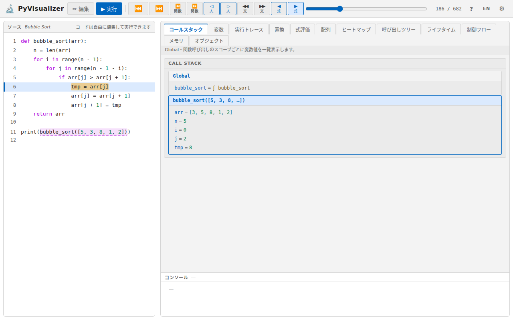

# PyVisualizer

> 🚀 **[Live Demo](https://tntetsu.github.io/PyVisualizer/)** — GitHub Pages でホスト中

> [English README](README.en.md)

> 📖 **[使い方（利用者向けマニュアル）](https://tntetsu.github.io/PyVisualizer/manual.html)** — 画面右上の「?」ボタンからも開けます

Python プログラムの実行過程をインタラクティブに可視化する教育用 Web アプリケーションです。

JavaScript 版の [JSVisualizer](https://github.com/tntetsu/JSVisualizer) と同じ画面・同じ **12 種類の可視化ビュー**で、Python のプログラムを式・文・関数呼び出しの各粒度でステップ実行できます。プログラムの動作（時間の経過とともにメモリの内容がどう変化するか）を、いろいろな見方で確かめられます。



インストールやログインは要りません。ブラウザで開くだけで使えます。コードはすべてブラウザの中で実行され、サーバーには送られません。

---

## 特徴

### Python 用に書いたインタプリタ

Python のプログラムは、PyVisualizer に組み込んだ Python のインタプリタ（JavaScript で書いたもの）で動かします。JavaScript に変換して動かす方式は採っていません。`[1, 2] + [3]`、`-7 % 3`、`if []:` のように JavaScript と Python で意味が違う式も、Python のとおりに計算します。

意味論の正しさは、同じプログラムを CPython（`python3`）でも実行し、**出力・例外の種類・変数の状態の変化の列**が一致することをテストで確かめています（[テスト](#テスト)）。

### ステップ実行の粒度（8 方向ボタン）

4 粒度 × 前後 = 8 種類のステップ操作ができます。

| 粒度 | ボタン | キーボード | 説明 |
|------|--------|-----------|------|
| **式評価** | ◀式 / ▶式 | `b`/`←`、`n`/`→` | 式を 1 つ評価するごと（最細粒度） |
| **人にやさしい単位** | ◁人 / ▷人 | `H` / `h` | 代入・条件判定・`for` のループ変数が次の値になるところ・関数の呼び出しなど、意味のある変化点だけ |
| **文評価** | ◀◀文 / ▶▶文 | `V` / `v` | 文単位（文の中の細かい計算は飛ばす） |
| **関数呼び出し単位** | ⏪関 / ⏩関 | `F` / `f` | 関数に入る・関数から戻るところまで |

その他：`Home` → 先頭へ、`End` → 末尾へ、`1`〜`9` → タブ切り替え、スライダーで好きな時点へ移動。

Python に合わせて、「人」の単位では次のところでも止まります。

- `for` の各回（ループ変数が次の値になるところ）
- 内包表記の各回
- `except` で例外を捕まえたところ

### コードハイライト（3 層）

| 層 | 色 | 意味 |
|----|-----|------|
| 行ハイライト | 🟦 青（左ボーダー＋背景） | 現在実行中の行 |
| 式ハイライト | 🟧 オレンジ（半透明） | 現在評価中の式の文字範囲 |
| 呼び出し元ハイライト | 🟣 パープル（破線アンダーライン） | 関数の中を実行中のとき、その関数を呼び出した式 |

### 可視化ビュー（12 種類）

ビューは JSVisualizer と共通です。**可視化対象**（何を見せるか）と**時間表現**（その時点を見せるか、経過をまとめて見せるか）の 2 軸で整理しています。

| カテゴリ | 可視化対象 | その時点を見る（アニメーション型） | 経過をまとめて見る（タイムライン型） |
|----------|-----------|------------------|----------------|
| **状態** | 変数の値 | 変数 | 実行トレース |
| | コールスタック | コールスタック | ライフタイム |
| | メモリ配置 | メモリ | — |
| **振る舞い** | 式の評価 | 式評価 | 置換 |
| | 文の実行 | 制御フロー | ヒートマップ |
| | 関数呼び出し | 呼び出しツリー | — |
| **複合型** | 配列（リスト） | 配列 | 実行トレース |
| | オブジェクト（辞書・インスタンス） | オブジェクト | — |

| タブ名 | 内容 |
|--------|------|
| 変数 | コードの各行 × 変数の表。各行を最後に実行したときの値を表示し、変わった値をオレンジの太字で強調 |
| 実行トレース | 代入や条件判定が起きたステップを実行順に一覧。条件式の True / False、リストと添字の位置の小さな図も表示 |
| コールスタック | 全体（Global）と、呼び出し中の関数ごとの変数の値 |
| ライフタイム | 横を時間、縦を呼び出しの深さとして、各関数の呼び出しがいつからいつまで続いたかを帯で表示 |
| メモリ | 変数（スタック）とリスト・辞書・インスタンスの実体（ヒープ）を分けて図示し、参照を矢印で表示 |
| 式評価 | 1 行の式が部分ごとに値に置き換わりながら最終的な値になるまでの過程。`and`/`or` で省略された部分は元の式のまま残る |
| 置換 | 再帰関数の呼び出しを、`fib(5)` → `fib(4) + fib(3)` → … のように置換モデルで展開 |
| 制御フロー | `if` の分岐を左右の列に分けたフローチャート。通った回数を表示し、一度も実行されなかった行はグレー |
| ヒートマップ | 各行の実行回数を色の濃さと「今までの回数 / 全体の回数」で表示。いつ実行されたかを点の並びで表示 |
| 呼び出しツリー | 関数の呼び出しを木で表示。各ノードに引数・戻り値と、その下の呼び出しの数（cost） |
| 配列 | リストの要素をマス目で表示し、`i` や `j` のような添字の変数が指す位置を表示 |
| オブジェクト | 辞書・インスタンスどうしの参照関係をグラフで表示（連結リスト・木構造の確認向け） |

各ビューの詳しい説明は[マニュアル](https://tntetsu.github.io/PyVisualizer/manual.html)を、分類の考え方は [JSVisualizer の README](https://github.com/tntetsu/JSVisualizer#可視化ビュー12-種類) を見てください。Python の値は Python の書き方で表示します（`True`/`False`/`None`、`'文字列'`、タプルの `(1, 2)`、辞書の `{'a': 1}`、`range(0, 5)` など）。

### input() の入力欄

PyVisualizer は、プログラムを最後まで一気に実行してから、ステップ実行で様子を見せます。そのため `input()` で読む行は、ソースの下の「入力」の欄にあらかじめ 1 行ずつ書いておきます。コンソールには、端末で実行したときと同じく、プロンプトの後に読んだ行が表示されます。

### わかりやすいエラー表示

構文エラーには、誤りのある行と、よくある原因の日本語の説明を表示します（`:` の付け忘れ、インデントのずれ、カッコの閉じ忘れなど）。実行時の例外は、`IndexError` のような Python の例外の名前と日本語の説明を表示し、例外が起きる直前までステップ実行でたどれます。

### その他

- **サンプルコード 27 種内蔵**（[下記](#サンプルコード27-種類)）
- **カスタムコード対応** — 自分で書いた Python のコードを貼り付けて実行
- **URL でコードを読み込む** — `code`・`exercise`・`view` のクエリパラメータで、外部に置いたコードを開ける（形式は JSVisualizer と同じ。[JSVisualizer の README](https://github.com/tntetsu/JSVisualizer#urlクエリでコードを外部から読み込む)）
- **テーマ** — ライト／ダーク（右上の ⚙）
- **表示言語** — 日本語／English（右上の EN / 日。Python のエラーメッセージは今のところ日本語だけ）
- **設定の保存** — テーマ・言語・ペイン幅・最後に見ていたタブをブラウザに保存

---

## 使える Python の範囲

| | 内容 |
|---|---|
| 値 | `int`（大きな整数も正確に計算）、`float`、`str`、`bool`、`None`、`list`、`tuple`、`dict`、`set`、`range` |
| 文 | 代入（アンパック、`+=` など、`a = b = 0`、スライスへの代入）、`del`、`if`/`elif`/`else`、`while`、`for`（どちらも `else` 付き可）、`break`/`continue`、`def`/`return`、`pass`、`global`/`nonlocal`、`class`、`try`/`except`/`else`/`finally`、`raise`、`assert`、`import math`/`from math import …` |
| 式 | 算術（`//`・`%`・`**` も Python の意味で）、比較の連鎖、`and`/`or`/`not`、`in`、`is`、負の添字、スライス、条件式、`lambda`、f 文字列、`%` 書式、内包表記（リスト・辞書・集合）、ジェネレーター式 |
| 関数の引数 | デフォルト引数、キーワード引数、`*args`/`**kwargs`、キーワード専用引数、`f(*xs, **d)` |
| クラス | `__init__`、メソッド、属性、継承（C3 の MRO）、`super()`、特殊メソッド（`__str__`・`__eq__`・`__lt__`・`__add__` など）、ユーザー定義の例外 |
| 組み込み関数 | `print`、`input`、`len`、`range`、`abs`、`min`、`max`、`sum`、`sorted`、`reversed`、`enumerate`、`zip`、`str`、`int`、`float`、`bool`、`list`、`tuple`、`dict`、`set`、`repr`、`round`、`chr`、`ord`、`isinstance`、`issubclass`、`type`、`hasattr`、`getattr`、`setattr`、リスト・文字列・辞書・集合の主なメソッド |
| まだ使えないもの | ジェネレーター（`yield`）、`with`、デコレーター、`async`、`match`、`math` 以外のモジュール、ファイルの読み書き |

CPython と表示が違うところ：

- PyVisualizer が出す例外のメッセージは初学者向けの日本語の説明（例外の型の名前は同じ。`raise` で投げた例外のメッセージは書いたとおり）
- 集合は入れた順に表示する（CPython はハッシュ値で決まる順）
- ジェネレーター式は、その場で全部計算したリストとして扱う
- インスタンスの既定の表示（`<__main__.Dog object>`）にアドレスを付けない
- 関数の呼び出しの深さの上限はおよそ 290 段（CPython は 1000 段）。実行は 50,000 ステップで止める

---

## サンプルコード（27 種類）

| 分類 | サンプル |
|------|---------|
| **探索** | 線形探索、二分探索 |
| **ソート（基本）** | バブルソート、選択ソート |
| **ソート（高度）** | クイックソート、マージソート |
| **ソート（辞書）** | 数値のキーでソート、文字列のキーでソート |
| **数学・アルゴリズム** | ユークリッドの互除法（ループ／再帰）、階乗、フィボナッチ数列（再帰／動的計画法）、大きな整数（階乗）、math モジュール |
| **データ構造** | 二分木・連結リスト（辞書で作ったもの）、単語の数え上げ（辞書） |
| **スコープ・Python** | クロージャ（`nonlocal`）、Python の機能（f 文字列・スライスなど）、内包表記、例外（`try`/`except`） |
| **クラス** | クラスと継承 |
| **Study Tasks** | [Warm-up] 階乗（ループ）、[Task 1] 選択ソート（バグあり）、[Task 2] フィボナッチ（呼び出し回数）、[Task 3] バブルソート（中間状態） |

サンプルは [samples/](samples/) に `.py` ファイルとして置いてあり、表示名と分類は [samples/samples.json](samples/samples.json) で決めています。

---

## 対象ユーザー

- **Python を学ぶ人** — 自分のコードの動作を一歩ずつ確認したい
- **教員** — 授業で動くプログラムを見せながら解説したい
- **教材制作者** — トレース図やアニメーションを手軽に作りたい

---

## 開発

### 構成

PyVisualizer は、JSVisualizer のフロントエンドと JSInterpreter の共通コアを使い、Python に固有の部分だけを持ちます。

| 部分 | 置き場所 |
|------|----------|
| Python のエンジン（構文解析・評価器・組み込み関数） | このリポジトリの [src/engine/](src/engine/) |
| Python の言語プロファイル（エディタ・色分け・値の表示） | このリポジトリの [src/lang/python.js](src/lang/python.js) |
| 実行の記録・ステップ操作（共通コア `js-interpreter/core`） | [JSInterpreter](https://github.com/tntetsu/JSInterpreter) の `feature/interp-core` ブランチ |
| 画面・12 種類のビュー | [JSVisualizer](https://github.com/tntetsu/JSVisualizer) の `feature/multilang` ブランチ |

共通コアと言語プロファイルは、まだ JSInterpreter・JSVisualizer の main（master）にはありません。そのため作業ブランチを `git worktree` で兄弟ディレクトリに取り出して使います。

### セットアップ

Node.js 22 以降と、テスト用に Python 3.12 以降（`python3`）が必要です。次の 5 つを同じ親ディレクトリに並べます。

```
親ディレクトリ/
├── PyVisualizer/
├── JSInterpreter/            # master
├── JSInterpreter-core/       # JSInterpreter の feature/interp-core（worktree）
├── JSVisualizer/             # main
└── JSVisualizer-multilang/   # JSVisualizer の feature/multilang（worktree）
```

```bash
git clone https://github.com/tntetsu/PyVisualizer.git
git clone https://github.com/tntetsu/JSInterpreter.git
git clone https://github.com/tntetsu/JSVisualizer.git
git -C JSInterpreter worktree add ../JSInterpreter-core feature/interp-core
git -C JSVisualizer worktree add ../JSVisualizer-multilang feature/multilang

# JSVisualizer の依存と、テストが読み込む JS のエンジン（JSInterpreter の master から作る）
(cd JSVisualizer-multilang && npm ci && npm run build:interp)

cd PyVisualizer
npm install
```

### ビルドと確認

```bash
node scripts/build.mjs --serve   # web/ にビルドして http://127.0.0.1:8123/ で配信
node scripts/build.mjs           # web/ にビルドだけする
```

### テスト

```bash
npm test
```

テストは Node 標準の `node:test` で書いています。CPython との比較テストは次の 2 種類です。

- [tests/oracle.test.js](tests/oracle.test.js) — 出力と例外の種類を比べる
- [tests/line-state.test.js](tests/line-state.test.js) — `sys.settrace` で取り出した変数の状態の変化の列を比べる

[samples/](samples/) と [tests/cases/](tests/cases/) に置いた `.py` は、自動で両方の対象になります。

### デプロイ

GitHub Actions（[.github/workflows/deploy.yml](.github/workflows/deploy.yml)）が、兄弟リポジトリの作業ブランチを取得し、テスト・ビルドのあと `web/` を GitHub Pages に公開します。

---

## 技術スタック

| 項目 | 採用技術 |
|------|----------|
| 構文解析 | [Lezer](https://lezer.codemirror.net/)（`@lezer/python`）＋自前の AST 変換・インデントの検査・構文エラーの説明 |
| Python の評価器 | 自作（LEGB スコープ、Python の演算・値の表現） |
| 実行の記録・ステップ操作 | [JSInterpreter](https://github.com/tntetsu/JSInterpreter) の共通コア |
| フロントエンド | [JSVisualizer](https://github.com/tntetsu/JSVisualizer)（Vanilla JS + HTML + CSS、CodeMirror 6、SVG） |
| ビルドツール | esbuild |
| テスト | `node:test`、CPython との比較テスト |
| CI/CD | GitHub Actions → GitHub Pages |

---

## ドキュメント

- [開発計画書](docs/development-plan.md)
- 報告書：[Phase 0](docs/phase0-report.md)・[1](docs/phase1-report.md)・[2](docs/phase2-report.md)・[3](docs/phase3-report.md)・[4](docs/phase4-report.md)・[5](docs/phase5-report.md)
- 設計上の決定（ADR）：[docs/adr/](docs/adr/)
- 利用者向けマニュアル：[日本語](manual/manual.html)・[English](manual/manual.en.html)

---

## 関連リポジトリ

- [JSVisualizer](https://github.com/tntetsu/JSVisualizer) — JavaScript 版。ビューの設計と評価については、その README の「論文・引用」を見てください
- [JSInterpreter](https://github.com/tntetsu/JSInterpreter) — JavaScript のインタプリタと、実行の記録の共通コア

---

## ライセンス

[MIT](LICENSE)
